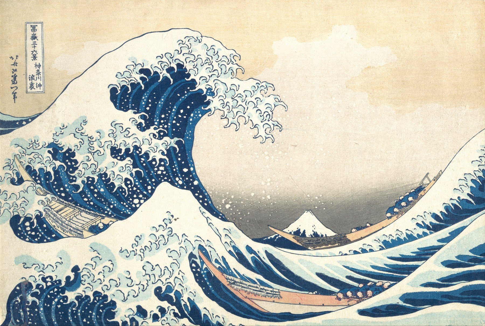
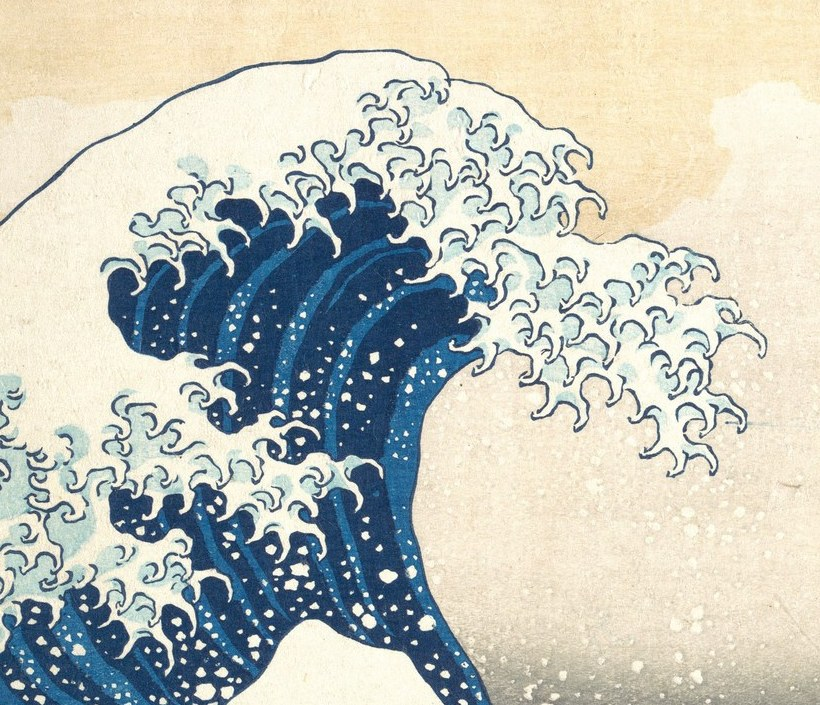
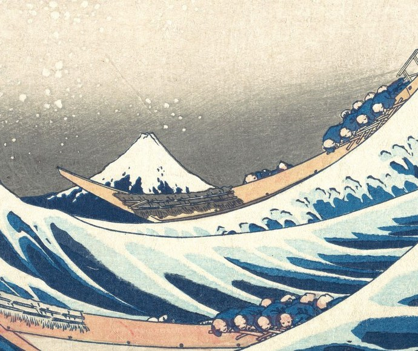

## 先读全幅，再决定看哪里

这张版画把高起的浪峰放在近处，把富士山留在较远的浪谷里。大都会艺术博物馆也将富士山描述为浪峰凹口中的小三角。先后顺序是本样稿对画面的阅读方法，不是作品唯一的解释。

## 近景：浪峰抓住第一眼

局部裁切让浪尖的轮廓、白色浪花和深蓝色块更容易辨认。它解释“视线先落在哪里”，但裁切本身不能代替全幅，也不应被当成另一件作品。

## 远景：把富士山放回尺度关系

再看浪谷中的山。与近浪相比，它更小，也离观者更远；这一组对照说明的是画面里的相对尺度，不推断真实海况、船只身份或创作意图。

| 馆藏字段 | The Met 记录 |
|---|---|
| 作品 | 《神奈川沖浪裏》（The Great Wave） |
| 年代 | ca. 1830–32 |
| 媒材 | 木版画；纸本墨与色彩 |
| 尺寸 | 25.7 × 37.9 cm |
| 馆藏号 | JP1847 |

::: note 来源与图像权利
The Met 45434（2026-11-02）。
API：isPublicDomain=true；Open Access：CC0。
https://www.metmuseum.org/art/collection/search/45434
https://collectionapi.metmuseum.org/public/collection/v1/objects/45434
https://www.metmuseum.org/about-the-met/policies-and-documents/open-access
:::
