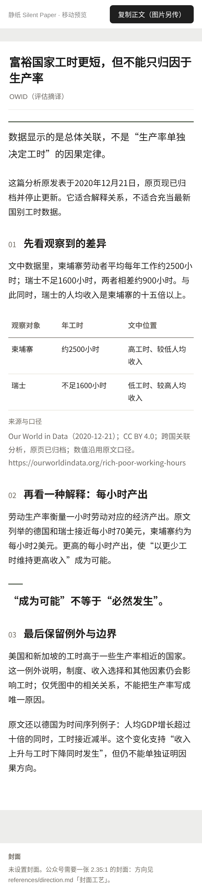
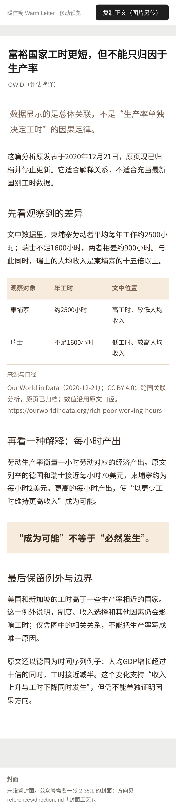
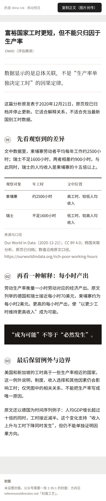
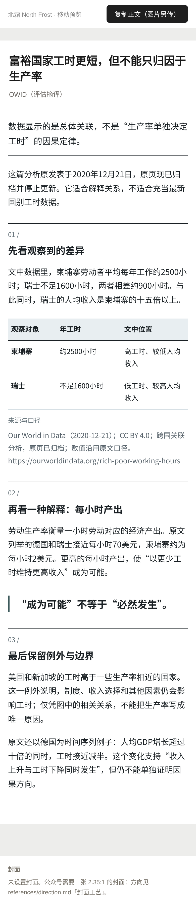
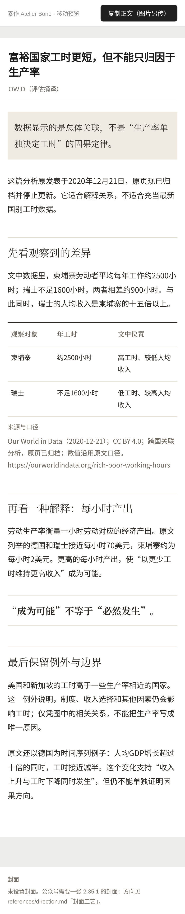
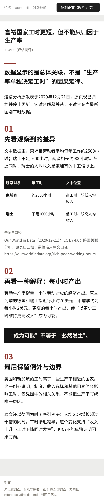

# 同稿六人格视觉对照（390px · 2x）

同一篇真实来源商业分析优化稿 `evaluation/cases/business.edited.md`，只切换人格；正文、数据、表格和来源保持一致。这里保留六张有展示价值的 390px 基线图；完整的 320／360／390／430px、首屏和合成语料证据由 Gate 3 生成到被忽略的 `assets/shots/`，CI 另行上传 artifact。

| `paper` · 静纸 | `letter` · 暖信笺 |
|---|---|
|  |  |

| `ink` · 酌墨 | `frost` · 北霜 |
|---|---|
|  |  |

| `bone` · 素作 | `folio` · 特稿 |
|---|---|
|  |  |

## 复现

```bash
python3 tests/run.py --shots --shoot examples/draft-handoff.md
cp assets/shots/personality_{paper,letter,ink,frost,bone,folio}.png evaluation/visual/
```

截图是视觉回归基线与通读证据，不是“浏览器启动成功即审美合格”的证明。浏览器或字体升级后应先通读差异，再决定是否更新基线；不要用像素哈希代替排版判断。
